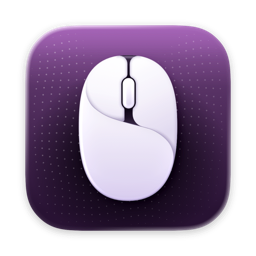
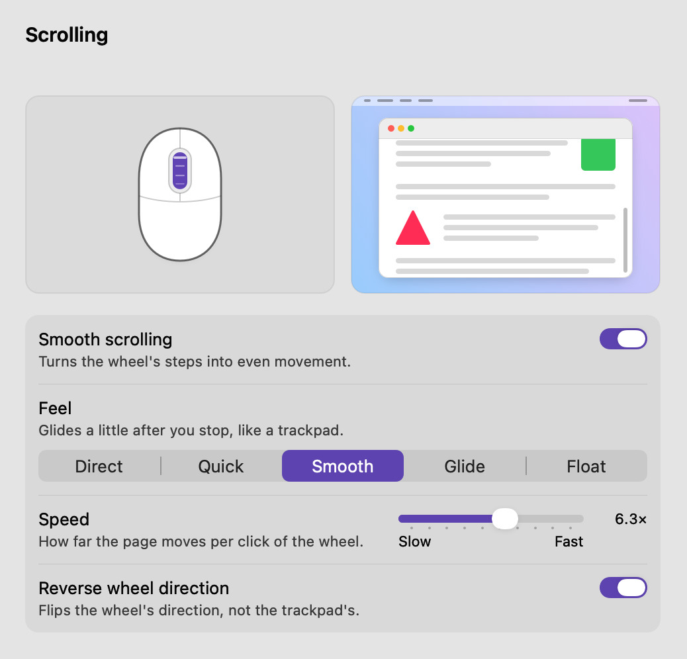
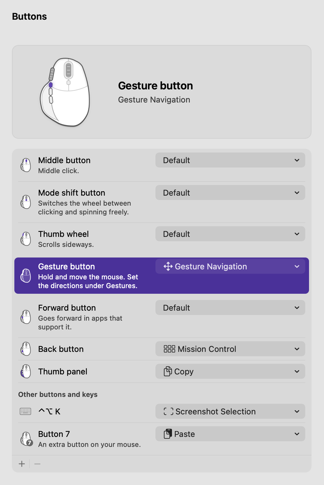
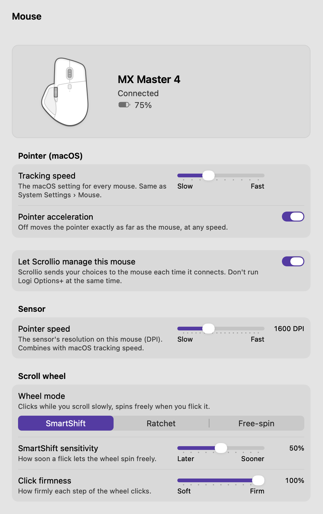
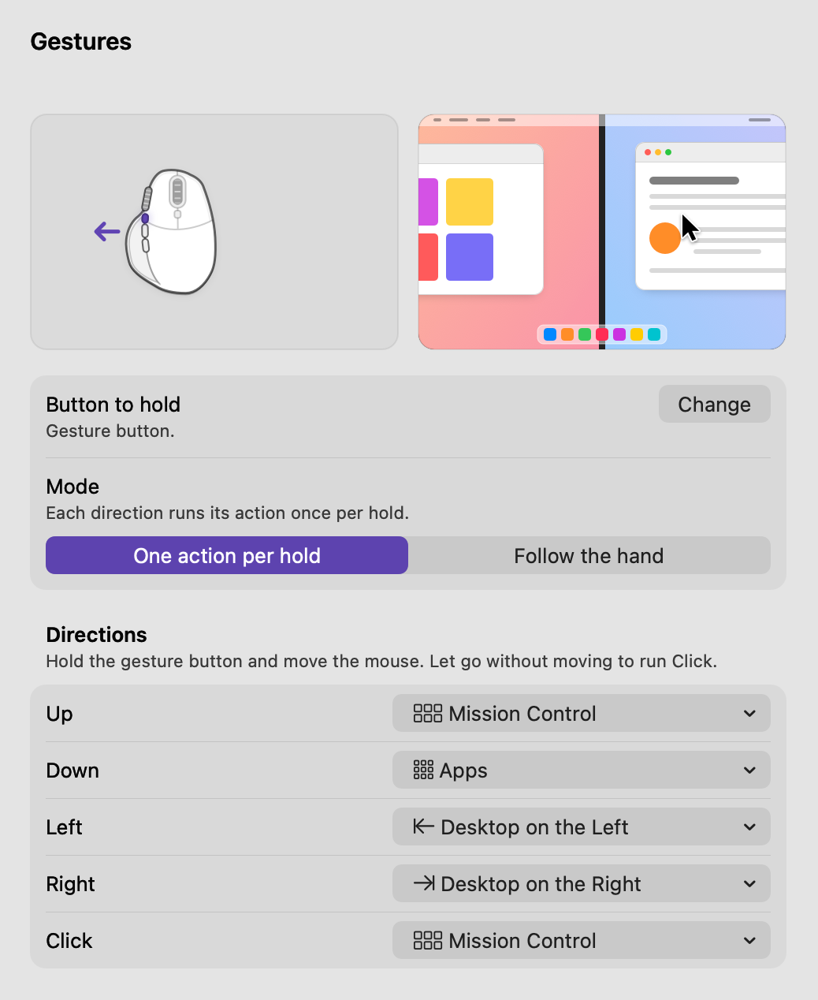
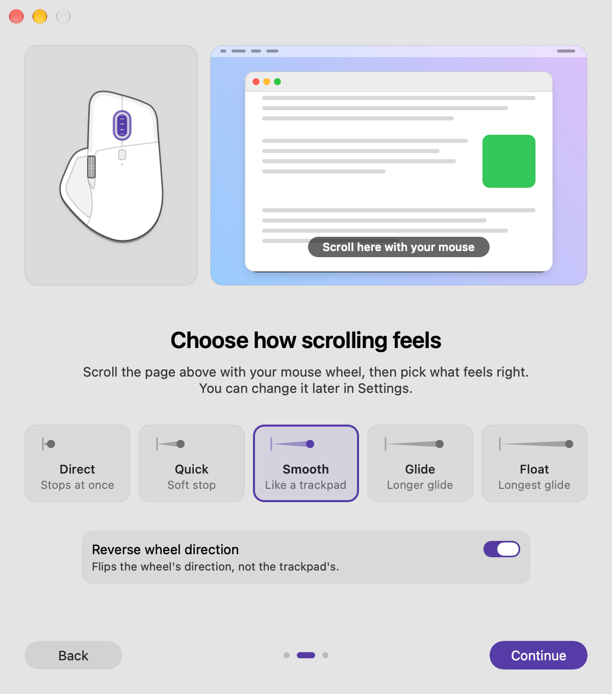

# Scrollio




**Smooth, trackpad-like scrolling for any mouse.**

Scrollio is a menu bar app for macOS. It makes a mouse's scroll wheel glide like a
trackpad, lets mouse buttons and keys run actions, adds mouse gestures and settings for
the sideways (thumb) wheel, and can manage the settings of Logitech MX mice.

It is based on [Mos](https://github.com/Caldis/Mos) by Caldis, may be used only for
non-commercial purposes, and is not affiliated with Apple or Logitech. See
[Licence and credits](#-licence-and-credits).

Download the latest disk image from the
[Releases page](https://github.com/Scorpio3310/scrollio/releases); what is in it, and how
to check it, is under [Download and first launch](#-download-and-first-launch). Or
[build it from source](#-build-from-source).

---

## ✨ Features

- ✅ **Smooth scrolling** – each click of the wheel glides out like a trackpad, in five feels from Direct to Float.
- ✅ **Per-app settings** – an app follows the Scrolling settings or keeps its own, or is left to macOS.
- ✅ **Buttons and keys** – give a mouse button, or a key with modifiers, a shortcut, a system action or an app to open.
- ✅ **Mouse gestures** – hold a button and move the mouse to switch desktops, open Mission Control and more.
- ✅ **Thumb wheel actions** – the sideways wheel can scroll, zoom, switch tabs or desktops, go back and forward, or set the volume.
- ✅ **Logitech MX settings** – battery, pointer speed, wheel mode and haptics of a Logitech MX mouse.
- ✅ **Menu bar item** – battery, Pause, and smoothing on or off for the app in front; the icon can be hidden.
- ✅ **Updates itself** – a released Scrollio asks GitHub once a day for a newer version, if you allow it, and installs only what carries the author's signature.
- ✅ **No tracking** – no analytics, no crash reporter. The update check is the only network request, and you can switch it off.

---

## 📸 Screenshots

<picture>
  <source media="(prefers-color-scheme: dark)" srcset="assets/readme/scrolling-dark.png">
  
</picture>

<table>
  <tr>
    <td width="50%" valign="top">
      <picture>
        <source media="(prefers-color-scheme: dark)" srcset="assets/readme/buttons-dark.png">
        
      </picture>
      <p><b>Buttons</b>: an MX Master 4's buttons in the order they sit on the mouse.</p>
    </td>
    <td width="50%" valign="top">
      <picture>
        <source media="(prefers-color-scheme: dark)" srcset="assets/readme/mouse-dark.png">
        
      </picture>
      <p><b>Mouse</b>: the settings of a Logitech MX mouse.</p>
    </td>
  </tr>
  <tr>
    <td width="50%" valign="top">
      <picture>
        <source media="(prefers-color-scheme: dark)" srcset="assets/readme/gestures-dark.png">
        
      </picture>
      <p><b>Gestures</b>: an action for each direction.</p>
    </td>
    <td width="50%" valign="top">
      <picture>
        <source media="(prefers-color-scheme: dark)" srcset="assets/readme/welcome-guide-dark.png">
        
      </picture>
      <p><b>Welcome Guide</b>: choose how scrolling feels.</p>
    </td>
  </tr>
</table>

---

## 🔍 In detail

Settings are in one window with a sidebar: Scrolling, Buttons, Gestures, Mouse, Apps and
General. On the first launch a Welcome Guide leads through Accessibility access, the feel
of scrolling and the menu bar icon.

### Smooth scrolling

- Five feels (Direct, Quick, Smooth, Glide and Float) set how long the page glides on;
  Speed sets how far one click moves it. A moving preview in the Scrolling pane shows the
  feel.
- Reverse wheel direction (the wheel only, not the trackpad).
- Under Advanced: an exact glide time, the smallest step, and
  "Trackpad-style scrolling (Beta)": apps treat the wheel like a trackpad and bounce at
  the ends of a page. Sideways scrolling stays as it is. What it does in which app, and
  its limits:
  [Trackpad-style scrolling (Beta)](#trackpad-style-scrolling-beta).
- While you hold a key: "Scroll faster" (5 × the distance), "Scroll sideways" and "Pause
  smoothing" (exact steps, for example to zoom with ⌘). A mouse button can hold them
  too. These keys work while Smooth scrolling is on.
- "Reset to Defaults" can be taken back: for a few seconds the button reads "Undo Reset".
- Per app (the Apps pane): an app uses the Scrolling settings or keeps its own. "Change
  scrolling only in these apps" leaves every other app to macOS; buttons and gestures
  still work everywhere. "Smooth Scrolling in …" in the menu bar menu turns smoothing on
  or off for the app in front.
- Trackpads and the Magic Mouse are left alone. With several displays, the motion is
  timed to the display under the pointer.

#### Trackpad-style scrolling (Beta)

Off by default. With it on, a wheel scroll up or down reaches an app in the form a
trackpad's scroll has: a touch, and for some apps a glide after it. Apps then treat the
wheel like a trackpad and bounce at the ends of a page. Scrollio sends the same motion as
with it off (to a Chromium-based app, at the Direct feel, a click now and then comes out a
pixel apart); only the form differs, and apps do not all read it the same way, so it is
sent in one of three ways:

- Chrome, Brave, Arc, Dia and the other browsers and apps built on Chromium (Electron
  apps such as VS Code and Slack, Spotify, a web app installed from such a browser), and
  Firefox and the other apps built on its engine (Thunderbird, Zotero): a short touch and
  then its glide. These apps move the page by every step they are sent, in the touch and
  in the glide, and bounce at a page's end by the glide's speed.
- Every other app: one touch that lasts until the scroll has run out, with no glide
  after it. These apps follow a touch to its end, and after a touch that ends at speed
  they add a glide of their own. So that they add nothing, the touch ends a fifth of a
  second after the page last moved; a turn of the wheel in that time goes on with the
  same touch. When something cuts a scroll short (a click, a finger on the trackpad, the
  wheel going on over another pane or another app, Pause), the touch ends at once, and
  Scrollio sends what a trackpad sends when two fingers tap it: by the notes of two other
  mouse tools (Mac Mouse Fix, LinearMouse), that is what stops an app that would glide on.
  For this form Scrollio has to know where the page ends, because such an app holds a
  page stretched past its end for as long as a touch lasts. While such a scroll runs it
  reads, through Accessibility, what kind of element is under the pointer and the
  position of that view's scroll bar; nothing else, and nothing of it is kept or sent.
  When the page reaches its end, the touch ends at once and the app bounces by itself;
  while the wheel still turns into that end, nothing more is sent; a scroll that starts
  at the end makes one small bounce. A view whose scroll bar cannot be read (no scroll
  bar, an app that does not answer in time) scrolls as with the switch off.
- Safari, the web apps made with its "Add to Dock" and the DuckDuckGo browser: on macOS
  27 and later the same short touch and glide as Chrome gets. For Safari this was seen on
  one screen (macOS 27.2, 2026-11-12: smooth, with the bounce; WebKit's own log said it
  followed every glide it was sent); DuckDuckGo is the same engine and was not seen. On
  macOS 14, 15 and 26 nothing changes for them: there the wheel's hardware event cannot be
  taken off what is sent, and with it on a glide these browsers do not scroll smoothly.
- Maps, Find My, Calendar, iPhone Mirroring, Blender and the Godot editor: nothing
  changes. By what people who use other mouse tools report, they do something else with a
  trackpad's scroll than with a wheel's (the wheel pans a map where it zoomed, or orbits
  a 3D view), or do not scroll as they should. For these the switch does nothing, and
  neither does their own "Trackpad-style scrolling (Beta)" switch when you give one of
  them its own settings in the Apps pane.

Scrolling sideways (with Shift, "Scroll sideways" or the thumb wheel) stays as it is with
the switch off, in every app. In a trackpad's form a sideways scroll is a swipe, and apps
go back or forward a page on it, or switch tabs.

What an app is sent also reads like a trackpad's events in the details: each has a time
of its own, evenly spaced (apps take the speed for a bounce from it), its own line count,
and, on macOS 27 and later, nothing of the wheel's hardware event left on it (with that
on a glide, a web view replaces the glide by one of its own). On macOS 14, 15 and 26 the
hardware event stays on, as before: taking it off was only run on macOS 27.

How sure this is. Nobody has seen this version on a screen yet. It was worked out from
how AppKit, WebKit, Chromium and Firefox handle a trackpad's scroll (read in their code,
AppKit's on macOS 27.2), from what other mouse tools send, and from measurements in a web
view that ran without a display (there every form arrived whole: 205 of a click's 205 px).
The form for "every other app" in mid-page was seen on a screen by one person, in
Finder and other Apple apps (nothing flies on). What it does at a page's end (the
reading of the scroll bar and all that follows from it) was written after that test and
seen on no screen yet; no test may read another app's interface, so that part has only
run against a stand-in.

Its limits:

- A list that macOS draws inside the windows of a Chromium-based app (the sidebar of Dia
  or Arc, Chrome's print dialog) gets that app's form, and may scroll shorter than the
  same list in Finder. An Open or Save dialog is drawn by a process of macOS's own: it is
  treated as "every other app", and an app's own settings in the Apps pane do not reach
  it. (From how macOS builds these dialogs; not checked on a screen.)
- An app outside the Applications folders is treated as "every other app", also when it
  is built on Chromium or on Firefox's engine: Scrollio looks into no bundle elsewhere
  (see [Privacy](#-privacy)).
- An app that tells a mouse from a trackpad by these events takes the wheel for a
  trackpad. In some 3D and design apps the wheel may then pan where it used to zoom. The
  ones Scrollio knows by name are left alone (above); Autodesk Fusion and Rhino are
  reported to be such apps too, and are not known by name. A game made with Godot has a
  name of its own and is not left alone either: by Godot's code a game that listens for
  the wheel's steps gets none from a trackpad's scroll (it gets a pan instead). Turn it
  off for such a game in the Apps pane.
- A scroll is either up-down or sideways. Turning the other wheel while a scroll still
  glides cuts that glide short with the switch off too (what the first wheel had left is
  dropped); with it on the scroll ends at once, so a little more is lost (a click and a
  sideways click 150 ms later: 124 of the 205 px, against 166 with the switch off).
  Pressing or letting go of "Scroll sideways" while a scroll with a trackpad's form still
  glides ends that scroll. And a sideways list does not bounce at its end.
- A device whose turns go both ways at once (a trackball, a wheel that tilts as it
  turns) keeps the kind of scroll it began with until the other direction leads two to
  one.
- When the wheel keeps turning at the end of an inner pane (a chat, a text box), the page
  around it may not take over until the scroll has ended and a new one begins; with the
  switch off it takes over at once. (From Firefox's code: an app keeps a trackpad's scroll
  on the pane it began on.)
- What ends the touch by itself is the display's next frame, a fifth of a second after
  the page last moved. Should the display send no frame then (suspected for a display
  that goes to sleep in that moment), the touch stays open until Scrollio's keeper ends
  it, 5 to 10 seconds later; that scroll's line in the log ends "ended by the keeper".
- At the end of a page: where the scroll bar can be read, the touch ends when the page
  arrives, a frame or two late (the reading follows the frames), so the page can go a
  little past its end before the app's own bounce takes over. A page that is at its end
  when a scroll starts there for the first time gets its small bounce and then plain
  scrolling, which can cut that bounce short; from the second time on the rest is held
  back. A page whose length changes while it scrolls (a list that loads more) can look
  for a moment as if it moved the wrong way: the rest of that scroll is then plain.
  Where the scroll bar cannot be read the scroll is as with the switch off: no stretch
  and no bounce.

If one app scrolls oddly with it, give that app its own settings in the Apps pane and
turn it off there.

### Buttons and keys

- The actions: a system shortcut (Mission Control and Spaces, apps and windows, editing,
  Finder, screenshots, navigation and more), a keyboard shortcut you record, a modifier
  key, another mouse button, one of the scroll keys, Gesture Navigation, or opening an
  app, a file or a script.
- The listed shortcuts (Select All, Undo, Copy and the rest) press the right key on every
  keyboard layout, and keys are named as your keyboard names them.
- To record a button or a key, click + and press it. Esc, a left click, closing the
  popover or switching to another app ends the recording.
- A drawing of the mouse lights the button each row is about. With an MX Master, its
  buttons are listed in the order they sit on the mouse, and any other buttons and keys
  under them:
  - MX Master 4: Middle button, Mode shift button, Thumb wheel, Gesture button, Forward
    button, Back button, Thumb panel.
  - MX Master 3 and 3S: Middle button, Mode shift button, Thumb wheel, Forward button,
    Back button, Gesture button.
- On a Logitech mouse, buttons that macOS does not report (such as the gesture button,
  the mode shift button and the thumb panel) can have actions too. With a Logitech mouse
  connected, a button, a key or a gesture can also run a Logitech action: switch the
  wheel mode, change the pointer speed, or switch the mouse to another computer.
- A row says when its button is also a scroll key, or when another app (Logi Options+)
  may take it over.
- Removing a button or an app can be undone (Edit › Undo).

### Mouse gestures

- Hold the button that has the action Gesture Navigation and move the mouse: up, down,
  left and right each run an action, and letting go without moving runs one more.
- Two modes: "One action per hold", and "Follow the hand", in which moving sideways
  slides the desktops with your hand, like a trackpad swipe. "Follow the hand" uses a
  private macOS interface; where it is missing, the mode is not available.
- "Freeze pointer during a gesture" keeps the pointer where it is while you hold the
  button.
- With a Logitech MX Master, the mouse can track the gesture itself (Beta), and an MX
  Master 4 can pulse when a gesture locks in.

### Thumb wheel

The sideways wheel (an MX Master's thumb wheel, or a wheel that tilts) has its own
settings, under Scrolling › Thumb wheel and, with an MX Master, in the Thumb wheel row of
the Buttons pane. They apply to every app.

- Action: Scroll Sideways (the default), Zoom, Switch Tabs, Switch Desktops, Back and
  Forward, or Volume.
- Speed, and Swap direction.

### Logitech MX mice

The Mouse pane shows a connected Logitech mouse's battery and, on mice that support them,
its settings:

- Sensor: Pointer speed (DPI).
- Scroll wheel: Wheel mode (SmartShift, Ratchet or Free-spin), SmartShift sensitivity and
  Click firmness.
- Haptics (MX Master 4): Haptic feedback and its strength, and how hard the thumb panel
  must be pressed.

Scrollio writes these settings to the mouse only while "Let Scrollio manage this mouse"
is on, and then only the values you set that the mouse does not already have, again each
time it connects. While the switch is off, the pane shows what the mouse reports. Do not
run Logi Options+ at the same time.

Apart from those settings, and whatever that switch says:

- For a Logitech-only button that has an action, and for a gesture button the mouse
  tracks itself, Scrollio asks the mouse to send that button to Scrollio, and gives it
  back when Scrollio pauses or quits.
- While you record a button in the Buttons pane, Scrollio asks the mouse for every
  button it can send (never the left or the right one), so that it can tell which one
  you press, and gives them back when the recording ends.
- A Logitech action changes the mouse when its button, key or gesture runs it.
- The gesture pulse plays on the mouse and can switch its haptics on, unless Haptic
  feedback is turned off.

A value written to the mouse is stored in the mouse: it stays after Scrollio quits or is
removed. If a Logitech button stops working after Scrollio crashed or was force quit,
switch the mouse off and on.

Logitech mice work over a Logitech receiver (Bolt or Unifying) or Bluetooth. A low
battery gets one notice at 10 % and one at 5 %, and its percentage stands next to the
menu bar icon until the mouse charges.

The same pane has two macOS settings for every mouse, "Tracking speed" and "Pointer
acceleration", as in System Settings › Mouse. Scrollio changes them only when you move
those controls.

### Menu bar

- The menu lists each Logitech mouse's battery, "Smooth Scrolling in …" for the app in
  front, "Pause Scrollio" or "Resume Scrollio", "Settings…" and "Quit Scrollio". A pause
  stops everything and gives the Logitech mice their buttons back; it is not kept after
  Scrollio quits. With Option held the menu also lists Logitech Diagnostics, a developer
  window with the HID++ details of the connected mice. In the released app it only reads.
- The icon is dimmed while Scrollio is paused, waits for Accessibility access, or could
  not start and tries again; its tooltip says which.
- The icon can be hidden (General › Show in menu bar). Opening Scrollio again then shows
  its settings, or the Welcome Guide while Accessibility access is missing.
- General also has "Open at login", the state of the Accessibility access and the
  [updates](#updates).
- Scrollio stops while the Mac sleeps or another user has it, and starts again when you
  are back.
- When its event handling starts (at launch once Accessibility access is there, on
  Resume) and whenever Mos starts later while it runs, Scrollio quits a running Mos and
  says so with a notice: two apps would both handle the same mouse events. While Scrollio
  is paused or still waits for the access, Mos is left running. Mos's settings are not
  read.
- Scrollio's notices stay on screen as long as their text takes to read (3 to 10
  seconds) and wait while the pointer is over them.

### Updates

A released Scrollio (the one from the disk image) updates itself, with
[Sparkle](https://sparkle-project.org). Version 1.0.0 cannot do this yet: from 1.0.0,
get the next version by hand, once.

- On its second launch Scrollio asks once whether it may check for updates
  automatically. Afterwards the answer is two switches under General › Updates: "Check
  for updates automatically" (once a day) and "Install updates automatically" (a new
  version is downloaded in the background and installed the next time Scrollio quits,
  for example when the Mac restarts). "Check Now" there, and "Check for Updates…" in
  the menu bar menu and in the Scrollio menu, ask at once; when there is nothing newer,
  or the check failed, one of Scrollio's notices says so.
- When a check finds a version, a window says what is new and offers to install it.
  Right after Scrollio started, or after you touched the update switches, it opens in
  front; at any other time it waits behind what you are doing, or, while Scrollio's
  settings are open, until Scrollio is next in front. Until you answer it, Scrollio sits
  in the Dock with a badge, its menu bar menu starts with "Update to Scrollio …" and
  General names the version.
- An update is installed only when its disk image carries a signature made with
  Scrollio's update key (or, should that key ever be replaced, the signature of the
  same Developer ID as the installed app), and that is checked before the image is
  opened. The app in it is signed with that Developer ID and notarized, like the
  download. macOS keeps the Accessibility permission across an update.
- A check asks GitHub for one small file that names the newest version. What that
  request shows is under [Privacy](#-privacy).
- A copy built from source does not update itself and asks nobody; neither does a copy
  that runs from the disk image. General › Updates says so.

---

## 💻 Requirements

- macOS 14 or later.
- Any mouse for scrolling, buttons and gestures. The Mouse pane's settings, the button
  list in mouse order and the mouse drawings are for Logitech MX mice (the drawings: MX
  Master 4, MX Master 3 and 3S, and a generic mouse).

---

## 📥 Download and first launch

Get the latest `Scrollio-<version>.dmg` from the
[Releases page](https://github.com/Scorpio3310/scrollio/releases). (The other way to get
Scrollio is to [build it from source](#-build-from-source).) Later versions arrive as
[updates](#updates); only 1.0.0 has to be replaced by hand.

A release is one disk image, `Scrollio-<version>.dmg`, for Apple silicon and Intel
Macs. The app in it and the image itself are signed with the author's Developer ID
(team `8C592KLVN6`) and notarized by Apple. A download from anywhere else, or one signed
by anyone else, is not an official build.

1. Open the disk image and drag Scrollio to the Applications folder. Open it from there,
   not from the disk image: opened from the image, Scrollio asks to be moved first.
2. macOS asks once whether to open an app that was downloaded from the internet.
3. The Welcome Guide opens. "Open Accessibility Settings" takes you to System Settings ›
   Privacy & Security › Accessibility: turn on Scrollio in the list. Until you do,
   Scrollio changes no scroll, button or key event.
4. Choose how scrolling feels, and whether Scrollio opens at login. It then runs in the
   menu bar; click its icon for Settings, Pause and Quit.

If Mos is running, Scrollio quits it once Accessibility access is there, and says so
(see [Menu bar](#menu-bar)). To go back to Mos, pause or quit Scrollio.

To check a download before you open it:

```bash
# the same sum as in the release notes
shasum -a 256 ~/Downloads/Scrollio-<version>.dmg
# "accepted", "source=Notarized Developer ID"
spctl -a -vv -t open --context context:primary-signature ~/Downloads/Scrollio-<version>.dmg
```

And the app, once it is in Applications:

```bash
# "accepted", "source=Notarized Developer ID"
spctl -a -vv /Applications/Scrollio.app
# "TeamIdentifier=8C592KLVN6"
codesign -dv --verbose=2 /Applications/Scrollio.app 2>&1 | grep -E "Authority|TeamIdentifier"
```

---

## 🧹 Uninstall

1. Quit Scrollio: "Quit Scrollio" in its menu bar menu, or ⌘Q while its Settings window is
   in front. Quitting gives a Logitech mouse its buttons back.
2. Move Scrollio from the Applications folder to the Trash.
3. In System Settings › Privacy & Security › Accessibility, select Scrollio and remove it
   with the minus button. In System Settings › General › Login Items, remove Scrollio if
   it is listed.
4. Delete its settings:

   ```bash
   defaults delete com.nikklemenc.Scrollio
   defaults delete com.nikklemenc.Scrollio.toast
   ```

5. Delete what the updater kept: a downloaded update, and what macOS stores for the
   app's web requests.

   ```bash
   rm -rf ~/Library/Caches/com.nikklemenc.Scrollio ~/Library/HTTPStorages/com.nikklemenc.Scrollio
   ```

What stays, because it was never Scrollio's to keep:

- Values written to a Logitech mouse (pointer speed, wheel mode, haptics and so on)
  are stored in the mouse. Change them with Logi Options+, or with Scrollio before you
  remove it.
- "Tracking speed" and "Pointer acceleration" are macOS settings: System Settings › Mouse.

---

## 🔐 Permissions

Scrollio asks for one permission: **Accessibility** (System Settings › Privacy &
Security › Accessibility). It needs it to receive the mouse's and the keyboard's events,
smooth the scrolling, run the actions of buttons, keys and gestures, and send the key
presses those actions make. Without it, no scroll, button or key event is changed. The
Welcome Guide leads you to the switch.

With "Trackpad-style scrolling (Beta)" on, the same permission is used for one more
thing, and only while a wheel scroll in its trackpad form runs in an app that is not a
browser: Scrollio asks that app which kind of element is under the pointer, which kinds
its containers are up to the first scroll area, and where that area's vertical scroll
bar stands (a number from 0 to 1). It reads no title, no text and no other value. It
never asks macOS for the permission by itself for this: where the access is missing,
nothing is read.

"Open at login" registers Scrollio as a login item; macOS may ask you to approve it in
System Settings under Login Items.

Key presses pass through Scrollio only while a key is bound to an action in Buttons,
while a button you hold stands for a modifier, or while you record a key in Settings.
Otherwise it only listens to them, for the keys under Scrolling › While you hold a key,
and cannot delay them.

A script a button runs is started as a program of its own: it has none of Scrollio's
permissions (not its Accessibility access), and macOS asks for the script's own when it
needs one. On a macOS without the function for this, it runs as Scrollio's child with
Scrollio's permissions, and the `app` log says so. More in [SECURITY.md](SECURITY.md).

---

## 🔒 Privacy

- The only network requests Scrollio makes are the updater's, and only in a released
  copy: it asks GitHub for the file `appcast.xml` of the newest release (once a day
  while "Check for updates automatically" is on, and when you choose "Check for
  Updates…" or "Check Now"), and it downloads the disk image from GitHub when an update
  is installed. Such a request shows GitHub what every web request shows, your IP
  address, and carries two things more: the app and its version
  (`Scrollio/1.0.1 Sparkle/2.10.1`) and the languages you prefer, which macOS adds to a
  web request. Nothing about your Mac or your settings is added: Sparkle's system
  profile is off and empty. With the switch off and no check asked for, a released copy
  makes no request either; a copy built from source never makes one.
- There is no analytics and no crash reporter. The "Open" button next to "Scrollio on
  GitHub" (General) hands the page to your web browser.
- Nothing else leaves your Mac. The settings are kept in Scrollio's preferences (the
  updater's own among them: your two choices and the time of the last check), and its
  log goes to the macOS system log on the Mac (see [Diagnostics](#-diagnostics)).
- Scrollio keeps no record of what you type. When key presses pass through it at all is
  under [Permissions](#-permissions); what it logs is under [Diagnostics](#-diagnostics).
- Besides its own settings, Scrollio reads:
  - the macOS keyboard shortcuts for Spaces (to run them), the keyboard layout in use
    (to press the right key for shortcuts such as ⌘A, and to name keys) and the macOS
    setting for natural scrolling (for "Follow the hand");
  - which app is under the pointer or in front, for the per-app settings and "Smooth
    Scrolling in …". With "Trackpad-style scrolling (Beta)" on, and while a wheel scroll
    runs in an app that is not a browser, it reads the kind of the element under the
    pointer and the position of that view's scroll bar (see [Permissions](#-permissions));
    the scroll log gets the kinds met ("AXRow", "AXScrollArea") and the bar's position,
    nothing else. With "Trackpad-style scrolling (Beta)" on it also looks once into the
    bundle of each app that comes to the front or that you scroll in, to see whether the
    app is built on Chromium or on Firefox's engine (the names in `Contents/Frameworks`,
    and whether `Contents/MacOS` holds a browser's app loader or Firefox's engine); only
    apps in the Applications folders and in /System are looked into;
  - the running apps, with their names and icons, to offer them in the Apps pane;
  - the macOS pointer settings, which it shows, and changes only as described under
    [Logitech MX mice](#logitech-mx-mice).

---

## 🔨 Build from source

You need a Mac with macOS 14 or later, Xcode 26 or later (the app icon is an Icon
Composer file) and an Apple Development signing identity; a free Apple account gives
one. Do not turn signing off: macOS ties the Accessibility permission to the code
signature.

The project signs for the author's team. To sign with yours, do not edit the project:

```bash
cp Local.xcconfig.example Local.xcconfig    # then put your Team ID into Local.xcconfig
```

`Local.xcconfig` is ignored by git, so the tree stays clean. `scripts/install.sh` passes
it to its build when it exists; for the plain `xcodebuild` commands below, add
`-xcconfig Local.xcconfig`. (In Xcode itself, choose your team under Signing &
Capabilities instead, and do not commit that change.) Without the file nothing is
different: the project's own settings are used.

To build the release app and install it in `/Applications`:

```bash
scripts/install.sh            # build, check, install, start
scripts/install.sh --check    # build and check only; nothing is installed
```

The script builds into `build/install` (or `$SCROLLIO_DERIVED_DATA`) and stamps the build
with its commit and date (shown under General). It installs a build only when:

- its signature verifies, is made with a certificate (not ad hoc) and has the same
  designated requirement as the installed app (a differently signed build would be asked
  for the Accessibility permission again; so a downloaded Scrollio has to be removed
  before a build of your own goes in its place, and the permission given again);
- its bundle identifier is `com.nikklemenc.Scrollio`;
- it carries no debugger entitlement (`get-task-allow`) and no code-coverage
  instrumentation.

It then quits the running copy, replaces `/Applications/Scrollio.app`, registers it again
with macOS so the Dock and Finder show the current icon, and opens it.

A build of your own does not update itself and makes no network request: only
`scripts/release.sh` gives a build the address of the update feed. (An update would put
the released app, signed by another certificate, in the place of yours, and macOS would
ask for the Accessibility permission again.) Take new versions with `git pull` and
build again.

Plain builds:

```bash
xcodebuild -scheme Debug -configuration Debug -destination 'platform=macOS' build    # Scrollio Debug.app
xcodebuild -scheme Debug -configuration Release -destination 'platform=macOS' build  # Scrollio.app
```

The debug build is a separate app, `Scrollio Debug.app` (`com.nikklemenc.Scrollio.debug`).
It has two developer windows more (Scroll Monitor and Test Toasts, in the menu bar menu
with Option held) and links [Charts](https://github.com/danielgindi/Charts) for the
Scroll Monitor's graph; the release app is built without both. Both apps embed
[Sparkle](https://github.com/sparkle-project/Sparkle), the updater, which stays off in
a build without an update feed.

---

## 🩺 Diagnostics

Scrollio writes what it did to the macOS system log, subsystem `com.nikklemenc.Scrollio`
(`com.nikklemenc.Scrollio.debug` for the debug build), in three categories. They stay
small: no line is written per wheel or pointer event, and no line says which key was
pressed.

```bash
# the last ten minutes
log show --last 10m --predicate 'subsystem == "com.nikklemenc.Scrollio"'
# one category, the last hour
log show --last 1h --predicate 'subsystem == "com.nikklemenc.Scrollio" AND category == "app"'
# live
log stream --predicate 'subsystem == "com.nikklemenc.Scrollio" AND category == "scroll"'
```

- `scroll`: one line per finished scroll, what the wheel asked for and what was sent:

  ```text
  scroll: 5 wheel events 2140 px in -> 83 frames 2134 px out (largest 94), wheel 44 ms,
  glide after the last event 1389 ms, Duration 4.50 (tau 230 ms), trackpad-style off, ended: glided out
  ```

  `trackpad-style` says in which form the scroll was sent: `off`; `on (flick: 1 touches,
  2 wheel events into a glide)` for an app built on Chromium or on Firefox's engine; `on
  (one touch: 1 touches)` for any other app; `off (not sent to this app)` for Safari and
  the other apps that are left alone while the switch is on; `off (a sideways scroll)`
  for a sideways scroll while it is on.
  The line ends with why the scroll ended: glided out, left click, a finger on the
  trackpad, the wheel went on in another app, trackpad-style was switched, the wheel
  turned between up-down and sideways, the scroll tap was restarted, ended by the keeper,
  or stopped. (With one touch a scroll's line comes a fifth of a second later than its
  last frame: the touch rests that long, and a turn of the wheel in that time is still
  the same scroll.) Also one `thumb wheel:` line per roll of
  the sideways wheel, and at
  most one line per reason every 3 seconds while wheel events are let through unsmoothed
  (trackpad events, a remote desktop, smoothing off for that event or that axis, no
  display link, a Step or Speed that is not a number).
- `logi`: what a Logitech mouse reported (battery, pointer speed, haptics, press force,
  wheel settings), each decision to write a value or not and why, the read-back after a
  write, requests the mouse refused or did not answer, gesture haptic cues, and slow
  writes. A gesture button that the mouse tracks itself writes one line per press
  (`raw XY: CID 0x01A0 released after 14 samples`). A mouse is named by its model, as the
  mouse reports it; never by a name you gave it in the Bluetooth settings.
- `app`: Scrollio's own health: each start and stop with its cause (launch, sleep and
  wake, another user, Pause, Accessibility access lost or back, quit), event taps that
  could not be created or that macOS turned off, restarts, settings that could not be
  read or written, an app, a file or a script that could not be opened (never its name
  or path), a held action whose release never came, at launch which accent colour is
  in effect, for "Trackpad-style scrolling (Beta)" whether the wheel's hardware event is
  taken off what an app is sent (once: at launch when the switch is on, in the Scrolling
  pane or for an app; else at the first scroll after you switch it on), what Safari gets
  and which form is under evaluation, and the updater: whether this copy updates itself, and one line per check
  with what it found:

  ```text
  Accent colour: the app's own (purple)
  Started (the Mac woke up): the event taps and the Logitech sessions run
  Updates: on, automatic checks on, automatic install off, feed at github.com
  Updates: a scheduled check found no newer version
  ```

The log you export from Logitech Diagnostics is more detailed than the `logi` category:
read it before you share it.

---

## 📄 Licence and credits

Scrollio is a modified version of **[Mos](https://github.com/Caldis/Mos)** by **Caldis**
and its contributors.

- Mos: Copyright © 2017–2026 Caldis and contributors.
- Scrollio's changes: Copyright © 2026 Nik Klemenc.

Mos is licensed under the
[Creative Commons Attribution-NonCommercial 4.0 International licence (CC BY-NC 4.0)](https://creativecommons.org/licenses/by-nc/4.0/),
and so is Scrollio. [LICENSE](LICENSE) holds these notices and the full text of the
licence.

**This work has been modified.** Scrollio is not the original Mos. Among the changes: a
new name, icon and bundle identifier; a reworked smooth-scrolling engine and simpler
scroll settings; the "Follow the hand" gesture mode; the thumb wheel's actions; settings
for Logitech MX mice (pointer speed, wheel, haptics, press force) and gestures tracked by
the mouse; the Mouse and Gestures panes, a battery in the menu bar, a main menu and a new
Welcome Guide; English as the only language; the original website and release tooling
removed, and updates set up anew (Sparkle 2, fed from this repository's GitHub
releases); macOS 14 as the minimum. The history of Mos up to
the fork is in its own repository, in its
[changelog](https://github.com/Caldis/Mos/blob/master/CHANGELOG.md) and its git history.

**Non-commercial use only.** Neither Scrollio nor anything derived from it may be used
for commercial purposes.

Caldis and the contributors to Mos do not endorse Scrollio and are not responsible for
it. Scrollio comes with no warranty.

Scrollio is not affiliated with or endorsed by Apple or Logitech. Apple, Mac and macOS
are trademarks of Apple Inc.; Logitech, MX Master, Logi Options+ and the other Logitech
product names used here are trademarks of Logitech.

### Acknowledgements

- [Mos](https://github.com/Caldis/Mos), the project Scrollio is built on.
- [Mac Mouse Fix](https://github.com/noah-nuebling/mac-mouse-fix) by Noah Nübling, the
  reference for the events behind "Follow the hand". Scrollio's code for it is its own,
  written from what Mac Mouse Fix's source shows, and so derived from it: the layout of
  the Dock swipe events (the event fields, and the HID event the Dock reads on macOS 27),
  the empty event that follows each of them, the 63 pt gap the Dock draws between two
  desktops, how a swipe's progress scales with the number of desktops, sending the final
  event again after 0.2 and 0.5 seconds, the travel after which a hold locks to a
  direction, and the pointer's late jump after it is moved back on macOS 27.
- [InstantSpaceSwitcher](https://github.com/jurplel/InstantSpaceSwitcher), a second
  reference for the format of the same events and its pitfalls (MIT licence).
- [Solaar](https://github.com/pwr-Solaar/Solaar), a reference for the Logitech HID++
  protocol: battery, pointer speed, the wheel, haptics, press force and the flags of a
  button's reporting. The names of the Logitech controls and the list of Logitech
  receivers are Solaar's tables (`special_keys.py` and `base_usb.py`), taken over with
  Mos. Solaar is licensed under the GNU General Public License, version 2.
- [OpenLogi](https://github.com/AprilNEA/OpenLogi), a reference for the same HID++
  features (pointer speed, battery, haptic feedback, press force, SmartShift), for the
  layout of an error answer, and for gestures tracked by the mouse: the haptic waveforms
  that are played and the jump in the first movement sample.
- [logiops](https://github.com/PixlOne/logiops), a reference for gestures tracked by the
  mouse (a button's raw movement and the haptic pulses).
- [Mouser](https://github.com/TomBadash/Mouser), a reference for battery, press force,
  the wheel and gestures tracked by the mouse.
- [Smoothscroll for websites](https://github.com/galambalazs/smoothscroll-for-websites),
  credited by Mos for its approach to smoothing.
- [Charts](https://github.com/danielgindi/Charts) (DGCharts, Apache License 2.0) draws
  the graph of the debug build's Scroll Monitor. The release app is built without it.
- [Sparkle](https://github.com/sparkle-project/Sparkle) (MIT licence) is the updater of
  the released app: it is embedded as it is distributed, and its helper programs are
  signed with Scrollio's Developer ID. Its licence names the code it includes, among it
  the [Ed25519 implementation](https://github.com/orlp/ed25519) by Orson Peters.

The same list, with the licences of Charts and Sparkle, is in
[Scrollio/Acknowledgements.txt](Scrollio/Acknowledgements.txt), which is part of the app
and of the disk image.

---

## 🤝 Contributing and security

Scrollio is one person's project. Issues are welcome; pull requests are read, but may
wait, and not every one will be merged: [CONTRIBUTING.md](CONTRIBUTING.md). A security
problem is reported privately, not in an issue: [SECURITY.md](SECURITY.md).

---

## 🧑‍💻 For developers

```bash
pgrep -fl "Scrollio Debug.app"     # must print nothing: quit a running debug app first
xcodebuild -scheme Debug -destination 'platform=macOS' test
xcodebuild -scheme Debug -destination 'platform=macOS' test -only-testing:ScrollioTests/<TestClassName>
scripts/qa/lint-logi-boundary.sh
```

The tests run inside `Scrollio Debug.app` with its startup side effects switched off:
the event taps and Logitech sessions are not started, the real settings are not written
and no login item is registered. Never add `CODE_SIGNING_ALLOWED=NO`: it re-signs the
debug app ad hoc, macOS then asks for the Accessibility permission again, and with a
running instance that prompt can freeze mouse and keyboard input. With a team of your
own, add `-xcconfig Local.xcconfig` to these commands too (see
[Build from source](#-build-from-source)). Tests that talk to a real Logitech mouse run
only when asked for:

```bash
xcodebuild -scheme Debug -testPlan DebugWithDevice -destination 'platform=macOS' test
```

### Making a release

A build for other people's Macs is made with `scripts/release.sh`, from a tagged commit:

```bash
scripts/update-key.sh                   # the update key is in the keychain and is the app's
scripts/release.sh --check              # build, sign and check; nothing is uploaded (needs no tag)
git tag -a v1.0.1 -m "Scrollio 1.0.1"   # the version being released
scripts/release.sh                      # the same, then notarized by Apple, packed and signed as an update
git push origin v1.0.1                  # that one tag, by name
```

Then publish the GitHub release for that tag with **both** files of `build/release`:
`Scrollio-<version>.dmg` and `appcast.xml`, the second under exactly that name. The
installed copies ask for `releases/latest/download/appcast.xml`: a newest release
without that file means their check fails, and no copy learns of the version.
`Scrollio-<version>-notes.md` is the text for the release.

- **Before the tag.** Give the version its part in [CHANGELOG.md](CHANGELOG.md)
  (`## 1.0.1`) and commit it: the update window shows that part to people with an older
  version, and the release notes start with it. Without it the script goes on and says
  that the window will not tell what is new.

- **Tags.** A release's version is its tag's: the commit must carry `v<version>`
  (`v1.0.0`), and the script refuses to release without it. The app and the image get
  that version; `MARKETING_VERSION` in the project is only what other builds show. Push
  the tag by name and never with `git push --tags`: a clone that also fetched the
  original project holds Mos's own tags (`1.0`, `1.0.0` and so on, without a `v`), which
  must not reach Scrollio's repository.
- **What it builds.** A universal Release app (Apple silicon and Intel) from an empty
  build folder, signed with the Developer ID certificate and stripped: an unstripped
  binary names the folders it was compiled in. Apple notarizes the app and the disk
  image.
- **Updates.** The script gives the build its update feed (no other build has one),
  signs Sparkle's helper programs with the Developer ID (they are distributed signed ad
  hoc, which Apple does not notarize), and after the image is notarized and stapled
  signs it with the update key and writes `appcast.xml` for it. The build number
  (`CFBundleVersion`, the number of commits) is what an installed copy compares: a
  release must be made from a commit later than the one before.
- **What it checks** before anything is uploaded: that the update key in the keychain is
  the one in `Scrollio/Info.plist` and can sign; the signature (Developer ID, team,
  hardened runtime, secure timestamp, no `get-task-allow`) of the app and of every
  program inside it; that signing the helpers left the app's designated requirement as
  the build made it (the Accessibility permission hangs on it); the feed and the key in
  the built app; both architectures, no code-coverage instrumentation, no debug map and
  no path of the build Mac anywhere in the app, debug symbols that belong to the
  binary, no Charts in the app, and the Logitech boundary lint. After the notarization:
  Gatekeeper's verdict on the app and on the image, and that the image's update
  signature verifies.
- **What it leaves** in `build/release`: `Scrollio-<version>.dmg` (the app, a link to
  Applications, `LICENSE.txt` and `Acknowledgements.txt`), `appcast.xml`,
  `Scrollio-<version>-notes.md` (the version's part of the changelog and the image's
  SHA-256) and `Scrollio-<version>.dSYM.zip`. The image and the appcast get their names
  only after the last check, so a run that fails leaves neither. Keep the `.dSYM.zip`
  and do not publish it: a crash report of that build cannot be read without it, and it
  holds the paths of the Mac it was built on.
- **What it needs**: a Developer ID Application certificate in the keychain,
  notarization credentials stored as the keychain profile `scrollio-notary`
  (`xcrun notarytool store-credentials "scrollio-notary" --team-id <team id>`), and the
  update key in the keychain. macOS asks once per tool whether it may use that key:
  "Always Allow".
- **The update key** is a key pair made once (`scripts/update-key.sh create`): the
  private half is in the login keychain of the Mac that makes releases, the public half
  is `SUPublicEDKey` in `Scrollio/Info.plist`. Keep one copy of the private half
  outside that Mac (`scripts/update-key.sh export <file>`, then into a password manager
  and the file deleted; `import <file>` brings it to another Mac). Whoever has it can
  sign what every installed copy would install. If it is lost, updates can go on with a
  new key as long as the image stays signed with the same Developer ID, which Sparkle
  accepts in place of the old key's signature: make a new key, put its public half into
  `Info.plist`, release. If the Developer ID changes as well, the installed copies
  cannot be updated and people have to download the new version by hand.

It installs nothing and leaves the project's signing settings as they are: the release
signature is not the development signature of the copy in `/Applications`. Before a
release is announced, open the image once on a Mac that never had Scrollio.

| Path | Contents |
| --- | --- |
| `Scrollio/` | The app: `ScrollCore`, `ButtonCore`, `InputEvent`, `Shortcut`, `Keys`, `Logi`, `Integration`, `MacPointer`, `Options`, `Managers`, `Update`, `Components`, `Windows`, `Utils` |
| `ScrollioTests/` | Unit tests (XCTest) |
| `Scrollio.xcodeproj/` | The Xcode project, schemes `Debug` and `Profile` |
| `scripts/` | `install.sh`, `release.sh` with `release-lib.sh`, `update-key.sh`, and in `qa/` the Logitech boundary lint (also run by a test) |
| `tools/` | Hand-run HID++ probes and a small regression harness (see its README before running a probe) |
| `assets/` | The pictures of this README |
| `AGENTS.md` | Rules for coding agents and contributors: build, tests, signing, module boundaries, strings |
| `CONTRIBUTING.md`, `SECURITY.md` | What to expect of issues and pull requests; how to report a security problem |
| `LICENSE`, `Scrollio/Acknowledgements.txt` | The licence with its notices; what Scrollio owes to other projects |
| `CHANGELOG.md` | What changed in each version: the text of the update window and of a release |
| `Local.xcconfig.example` | The template of `Local.xcconfig`, a Mac's own signing team |
